```{r setup, include=FALSE}
# Set the project root directory
project_root <- "C:/Users/user/Documents/Campus Energy Consumption Analytics"

knitr::opts_knit$set(root.dir = project_root)

# Tell knitr to resolve images from the project root
knitr::opts_chunk$set(
  echo = FALSE,
  warning = FALSE,
  message = FALSE,
  fig.align = "center",
  out.width = "90%",
  fig.path = "Campus_Energy_Consumption_Analytics_files/figure-html/"
)
```


## 1. Project Overview

This project focuses on the analysis of electrical energy consumption using a real-world historical campus energy dataset.

The project uses the publicly available **I-BLEND (Indian BuiLdings Energy coNsumption Dataset)** as a case-study dataset. I-BLEND was collected at the **Indraprastha Institute of Information Technology Delhi (IIIT-Delhi), New Delhi, India**.

The objective of this project is to apply Business Analytics techniques in **R** to:

- understand electrical energy consumption patterns,
- examine relationships between energy consumption and occupancy,
- analyze the influence of working days and campus activity,
- identify high-consumption periods,
- develop energy-consumption forecasting models,
- evaluate hypothetical energy-saving scenarios.

The dataset represents a **historical case study of the IIIT-Delhi campus**. It is not data collected from the user's college or from the current year. Therefore, the results will be interpreted as observations from the source campus and as a methodological example of campus energy analytics.

------------------------------------------------------------------------

# 2. Dataset Selection

## 2.1 Selected Dataset: I-BLEND

The **I-BLEND dataset** was selected because it provides fine-grained electrical energy measurements from multiple building types within an academic campus.

The dataset was collected at **IIIT-Delhi** and contains electrical energy data from seven buildings:

- Academic Building
- Lecture Building
- Library Building
- Facilities Building
- Dining Building
- Boys' Dormitory
- Girls' Dormitory

The original energy dataset contains approximately **52 months of electrical measurements at one-minute resolution**.

Supplementary information includes:

- Occupancy data at ten-minute resolution
- Institute calendar information
- Weather data
- Building-related information

The electrical energy records contain:

- Power
- Current
- Voltage
- Frequency
- Power factor

## 2.2 Historical Nature of the Dataset

The I-BLEND dataset is a historical dataset rather than a current 2025/2026 dataset.

According to the original dataset documentation:

- Energy data was considered through **December 31, 2017**.
- Occupancy data was available from **February 16, 2014 to November 3, 2017**.
- Local weather measurements at IIIT-Delhi were collected for approximately four months in **2018**.

Therefore, this project does **not** attempt to describe current energy consumption in 2025 or 2026.

Instead, the historical dataset is used to demonstrate how campus energy data can be processed, analyzed, modeled, and used for forecasting and energy-management analysis.

## 2.3 Dataset Source

### Official I-BLEND Dataset Collection

[I-BLEND Dataset Collection](https://springernature.figshare.com/collections/I-BLEND_a_campus_scale_commercial_and_residential_buildings_electrical_energy_dataset/3893581/1)

### Energy Dataset of IIIT-Delhi

[Energy Dataset of IIITD — Springer Nature Figshare](https://springernature.figshare.com/articles/dataset/Energy_dataset_of_IIITD/6007637)

### Research Paper

[Rashid, H., Singh, P. & Singh, A. (2019). I-BLEND, a campus-scale commercial and residential buildings electrical energy dataset. Scientific Data.](https://www.nature.com/articles/sdata201915)

------------------------------------------------------------------------

# 3. Dataset Download and Organization

The I-BLEND dataset was downloaded from the official dataset source.

The accompanying research paper and documentation were retained for understanding the dataset structure, measurement methodology, time periods, and limitations.

The raw dataset files were preserved without directly modifying the original source files.

The project was organized into separate folders for raw data, processed data, R scripts, results, plots, and documentation.

The project structure is:

``` text
Campus Energy Consumption Analytics/
│
├── data/
│   ├── raw/
│   │   ├── energy/
│   │   ├── occupancy/
│   │   ├── calendar/
│   │   └── weather/
│   │
│   └── processed/
│
├── documentation/
│
├── R/
│
├── plots/
│
├── results/
│
├── reports/
│   ├── figures_final/
│   │   │
│   │   ├── energy_savings/
│   │   │   ├── 10g_annual_energy_savings_comparison.png
│   │   │   ├── 10g_annual_observed_energy.png
│   │   │   ├── 10g_energy_savings_comparison.png
│   │   │   └── 10g_remaining_energy_comparison.png
│   │   │
│   │   ├── recommendations/
│   │   │   ├── 11_annual_data_coverage.png
│   │   │   └── 11_recommendation_priority.png
│   │   │
│   │   └── forecasting/
│   │       ├── actual_vs_predicted_refined.png
│   │       ├── detailed_daily_energy_trend_refined.png
│   │       ├── detailed_monthly_energy_refined.png
│   │       ├── forecast_error_by_hour.png
│   │       ├── forecast_residuals_over_time_refined.png
│   │       └── forecasting_moving_block_bootstrap.png
│   │
│   └── deliverables/
│
├── Campus Energy Consumption Analytics.Rproj
├── Campus_Energy_Consumption_Analytics.Rmd
├── Campus_Energy_Consumption_Analytics.html
└── .gitignore
```

The raw datasets were separated into:

1.  Energy
2.  Occupancy
3.  Calendar
4.  Weather

Unnecessary system-generated files such as `__MACOSX` and `.DS_Store` were removed.

------------------------------------------------------------------------

# 4. Data Inventory

The first R script, `01_data_inventory.R`, was created to identify and categorize the available CSV files.

The inventory classified the files into:

- Energy datasets
- Occupancy datasets
- Calendar datasets
- Weather dataset

The inventory results were saved as:

``` text
results/file_inventory.csv
```

------------------------------------------------------------------------

# 5. Data Inspection

The second R script, `02_inspect_data.R`, was created to inspect the structure and contents of the datasets.

The inspection included:

- Column names
- Data types
- Sample observations
- Timestamp format
- Missing values
- Dataset dimensions
- Time resolution

The inspection confirmed approximately one-minute resolution for the primary energy data and ten-minute resolution for the occupancy datasets.

------------------------------------------------------------------------

# 6. Data Validation

The third R script, `03_validate_data.R`, was created to validate the datasets before cleaning and aggregation.

The validation included:

- Chronological ordering
- Duplicate timestamps and rows
- Time intervals and irregular gaps
- Missing values
- Occupancy completeness
- Calendar completeness

The results were saved as:

``` text
results/validation_summary.csv
```

The validation identified missing observations and irregular time gaps in some energy and occupancy streams.

These issues were not blindly corrected or filled. Coverage information was retained for later analysis.

------------------------------------------------------------------------

# 7. Data Cleaning

The fourth R script, `04_clean_data.R`, was created to clean and standardize the energy data.

The following operations were performed:

- Converted Unix timestamps into date-time values.
- Used the `Asia/Kolkata` timezone.
- Converted relevant variables to numeric format.
- Created combined Boys' dormitory measurements where appropriate.
- Created combined Girls' dormitory measurements where appropriate.
- Assessed missing values.
- Preserved important missing-data information.

The processed files are:

``` text
data/processed/energy_clean_minute.rds
data/processed/energy_clean_minute.csv
results/energy_missing_summary.csv
```

------------------------------------------------------------------------

# 8. Hourly Energy Aggregation

The fifth R script, `05_hourly_aggregation.R`, was created to transform minute-level energy measurements into an hourly analytical dataset.

Minute-level power measurements were converted into hourly energy values using the available observations.

Hourly coverage was calculated to identify incomplete hours.

The following time variables were created:

- Date
- Hour
- Day of week
- Month
- Year

Building-level hourly energy variables were retained.

## 8.1 Building Availability

Some buildings contain substantial periods of missing data. Therefore, hourly coverage information was retained rather than treating all building measurements as equally complete.

## 8.2 Analytical Campus-Level Energy Measure

An analytical campus-level energy measure was created using a project-specific coverage rule.

An hour is considered suitable when energy information is available from at least **5 of the 7 building-level measures**.

This is an analytical decision made for this project and is **not a rule defined by the original I-BLEND dataset**.

The resulting hourly dataset contains:

``` text
38,520 hourly observations
```

Generated files:

``` text
data/processed/energy_hourly.rds
data/processed/energy_hourly.csv
results/hourly_coverage_summary.csv
```

------------------------------------------------------------------------

# 9. Occupancy Feature Processing

The sixth R script, `06_merge_features.R`, was created to integrate occupancy information with the hourly energy dataset.

All seven occupancy datasets were processed individually.

The original occupancy timestamps were converted to `Asia/Kolkata` date-time values and aggregated to hourly observations.

## 9.1 Hourly Occupancy Features

Two occupancy features were retained:

- **Hourly mean occupancy**
- **Hourly peak occupancy**

Hourly mean occupancy represents the average observed occupancy during the hour.

Hourly peak occupancy represents the highest observed occupancy during the hour.

The number of available occupancy observations was also retained so that occupancy coverage could be evaluated.

## 9.2 Occupancy Data Limitation

The original I-BLEND occupancy data was generated using Wi-Fi-based measurements.

The dataset documentation notes that occupancy estimates can contain overestimation when a person has multiple connected devices and underestimation when a person does not connect to the Wi-Fi network.

Therefore, occupancy values are treated as an observed occupancy measure rather than an exact physical headcount.

------------------------------------------------------------------------

# 10. Institute Calendar Integration

The institute calendar files were combined into a single calendar dataset.

The following variables were created:

- Working-day indicator
- Activity information
- Activity-level classification

The calendar information was then merged with the hourly energy dataset.

After merging:

``` text
Hourly rows: 38,520
Missing calendar rows: 0
```

------------------------------------------------------------------------

# 11. Final Feature Dataset

The energy, occupancy, and calendar datasets were merged into a single hourly analytical dataset.

The resulting dataset contains:

- Hourly energy measurements
- Building-level energy variables
- Energy coverage information
- Hourly mean occupancy
- Hourly peak occupancy
- Occupancy observation counts
- Working-day information
- Calendar activity information
- Date and time features

The final processed files are:

``` text
data/processed/energy_hourly_with_features.rds
data/processed/energy_hourly_with_features.csv
results/occupancy_hourly_coverage.csv
```

At this stage, the **data preparation and feature-integration phase is complete**.

------------------------------------------------------------------------

# 12. Exploratory Data Analysis

Exploratory Data Analysis (EDA) was completed to understand the historical energy-consumption patterns and assess the availability of the underlying measurements.

The analysis covered:

- Overall energy-consumption trends.
- Hourly, daily, monthly, and weekday patterns.
- Working-day and non-working-day comparisons.
- Building-level consumption patterns.
- Occupancy patterns and occupancy-energy relationships.
- Energy-data coverage and availability.

Visualizations and supporting summary tables were saved in the `plots/` and `results/` directories.

## 12.1 EDA Interpretation

The EDA was interpreted alongside meter coverage. Because the set of buildings contributing to a campus total can vary over time, changes in the calculated total are not automatically treated as changes in actual campus demand.


### Figure 1. Overall Energy Trend

```{r fig-overall-energy-trend, echo=FALSE, out.width="90%", fig.align="center", fig.cap="Overall historical campus energy trend using corrected observations."}
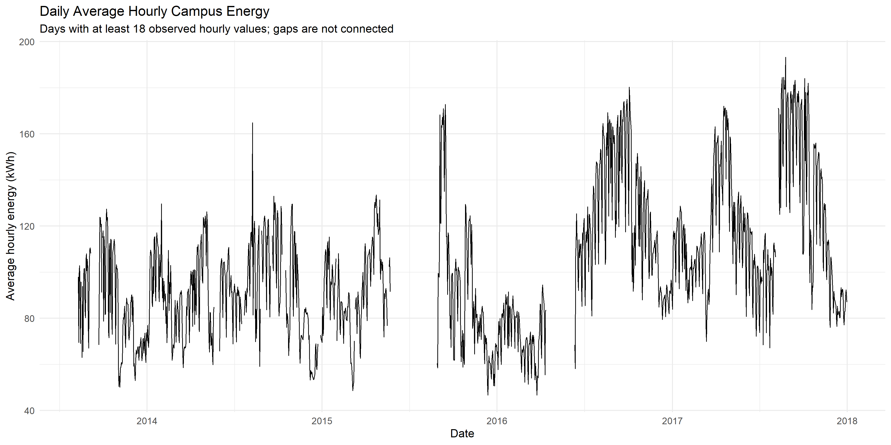
```

### Figure 2. Energy Data Coverage

```{r fig-energy-coverage, echo=FALSE, out.width="90%", fig.align="center", fig.cap="Availability of valid energy observations across the study period."}
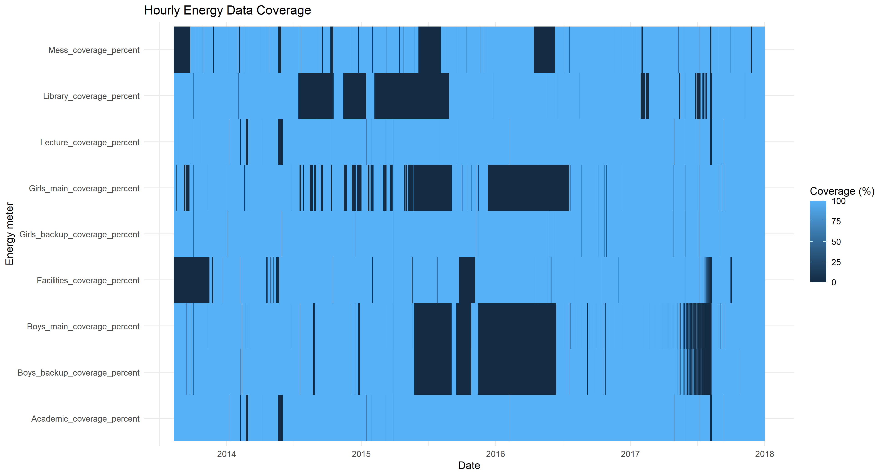
```

### Figure 3. Hourly Energy Profile

```{r fig-hourly-profile, echo=FALSE, out.width="90%", fig.align="center", fig.cap="Average hourly energy consumption profile."}
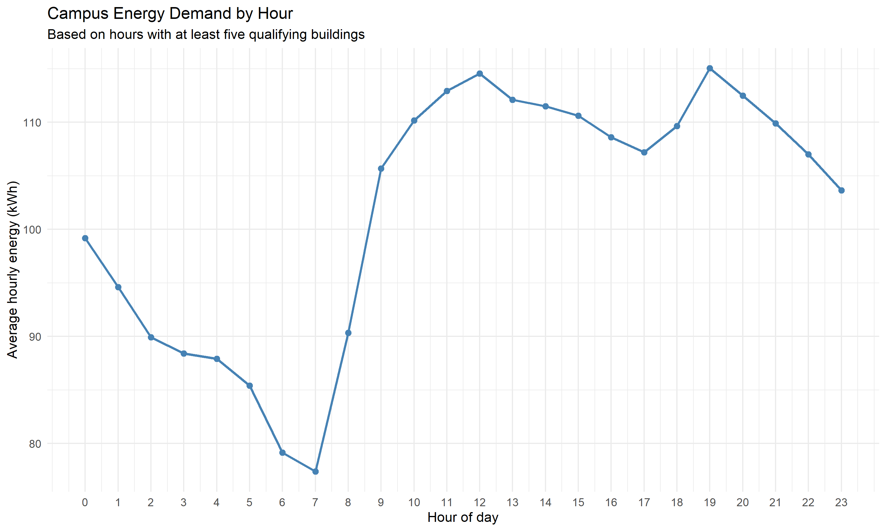
```

### Figure 4. Occupancy and Energy Relationship

```{r fig-occupancy-energy, echo=FALSE, out.width="90%", fig.align="center", fig.cap="Relationship between estimated occupancy and energy consumption. Occupancy values are Wi-Fi-derived estimates."}
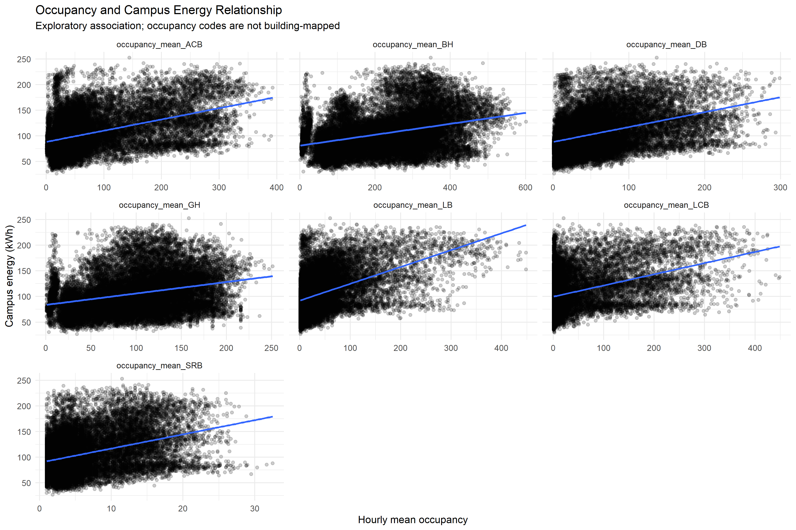
```


------------------------------------------------------------------------


# 13. Energy Consumption Analysis

The building-level and campus-level energy-consumption analysis was completed.

The analysis included:

- Average, median, and peak consumption statistics.
- Hourly, weekday, and monthly patterns.
- Daily energy-consumption trends.
- High-demand hours and peak-demand observations.
- Building comparisons using a minimum hourly meter-coverage threshold of 75%.
- Campus-level analysis requiring at least five qualifying buildings.

The 95th percentile of campus energy demand was used as an analytical threshold for identifying high-demand hours. This is a project-defined threshold, not an official standard.

Data-quality checks were also performed. Zero readings and statistical outliers were flagged for investigation rather than automatically deleted or treated as errors.

### Figure 5. Building-Level Energy Analysis

```{r fig-building-energy, echo=FALSE, out.width="90%", fig.align="center", fig.cap="Comparative building-level energy consumption analysis."}
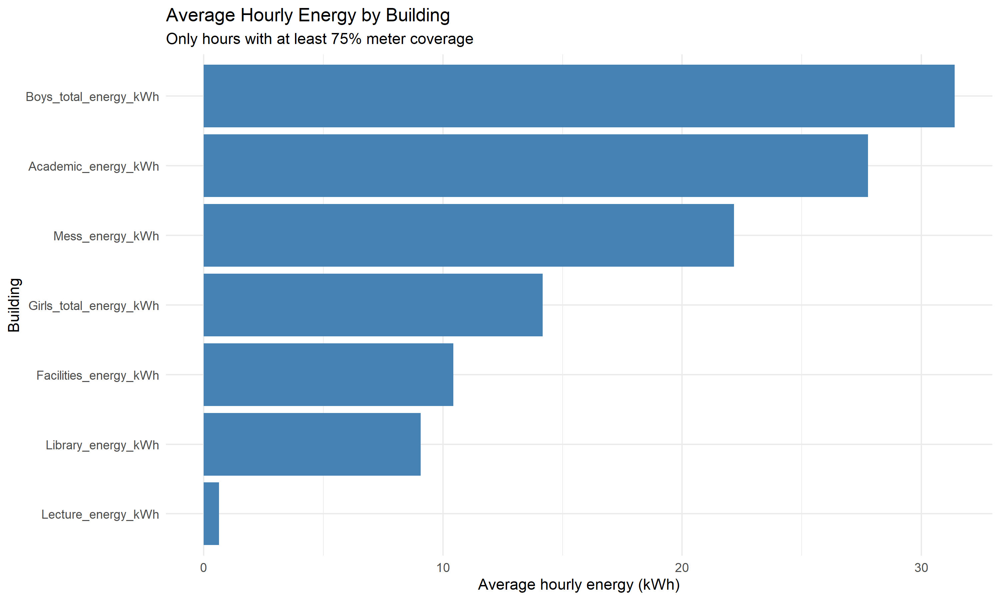
```

### Figure 6. Weekday Energy Profile

```{r fig-weekday-energy, echo=FALSE, out.width="90%", fig.align="center", fig.cap="Energy consumption patterns across different weekdays."}
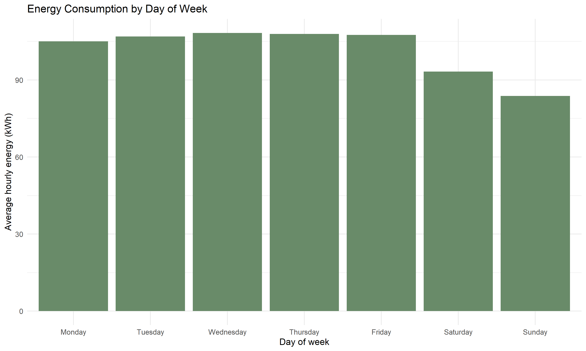
```

------------------------------------------------------------------------

# 14. Forecasting and Prediction

Forecasting was completed using a continuous observed period so that missing intervals were not silently imputed.

## 14.1 Forecasting Dataset and Validation

- Selected continuous observed run: **9,370 hourly observations**.
- Chronological training set: **7,496 observations (80%)**.
- Chronological test set: **1,874 observations (20%)**.
- Training period: 2016-06-10 09:00 to 2017-04-18 16:00.
- Test period: 2017-04-18 17:00 to 2017-07-05 18:00.

The reported model evaluation uses **rolling one-step-ahead predictions**. This is not the same as a fixed-origin forecast made many hours into the future.

### Figure 7. Forecasting Training and Testing Split

```{r fig-forecast-split, echo=FALSE, out.width="90%", fig.align="center", fig.cap="Chronological training and testing split used for forecasting evaluation."}
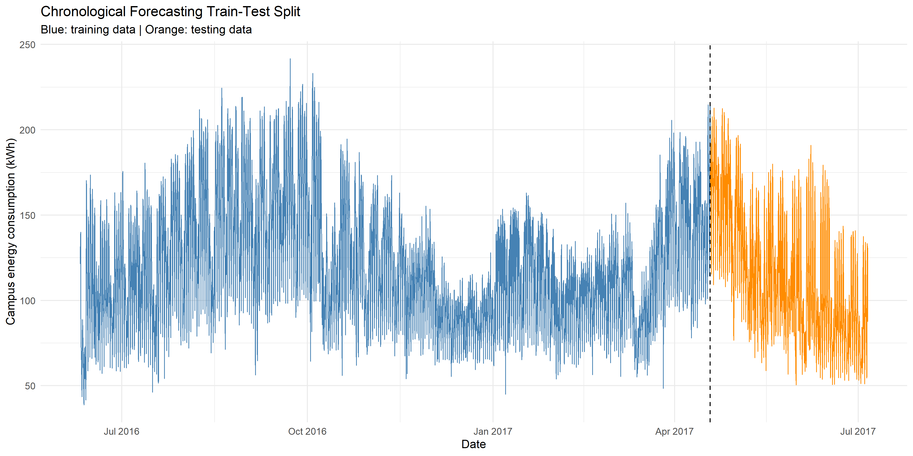
```

## 14.2 Model Comparison

| Model | MAE | RMSE | Bias (predicted − actual) |
|---|---:|---:|---:|
| Naive — previous hour | 9.1878 | 13.4385 | 0.0524 |
| Seasonal naive — 24 hours | 16.4669 | 24.4799 | 0.9647 |
| Linear trend | 30.2271 | 36.5729 | -5.9802 |
| Calendar regression | 28.9048 | 34.2788 | 5.7982 |
| Lag-based regression | **8.8221** | **12.0990** | 0.5284 |

The lag-based regression achieved the lowest MAE and RMSE among the evaluated models. Its MAE was approximately **3.98% lower** than the previous-hour naive baseline. This is a modest improvement, not evidence of a major forecasting breakthrough.

The naive baseline had a lower median absolute error, so the lag-based model was not better on every error measure or every test observation.

## 14.3 Robustness and Uncertainty

The lag-based model had lower absolute error than the naive baseline on 1,025 of 1,874 test observations (54.70%). It performed better on 14 of 24 evaluated test weeks.

Moving-block bootstrap confidence intervals for the MAE improvement included zero for all tested block lengths (3, 7, and 14 days). Therefore, the evidence that the lag-based model consistently outperforms the naive baseline is **not conclusive**.

The model is best treated as an experimental planning aid that should be monitored against a simple baseline, not as a production-ready operational forecasting system.

### Figure 8. Actual Versus Predicted Energy

```{r fig-actual-predicted, echo=FALSE, out.width="100%", fig.align="center", fig.cap="Actual versus predicted energy using the selected lag-based regression model. Predictions use rolling one-step-ahead evaluation."}
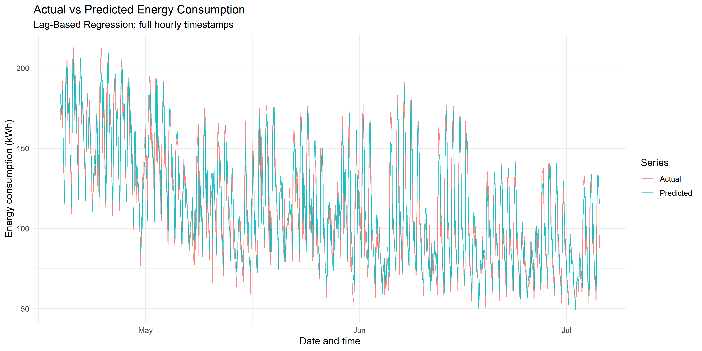
```

### Figure 9. Forecast Residuals Over Time

```{r fig-forecast-residuals, echo=FALSE, out.width="100%", fig.align="center", fig.cap="Forecast residuals over time, calculated as actual energy minus predicted energy."}
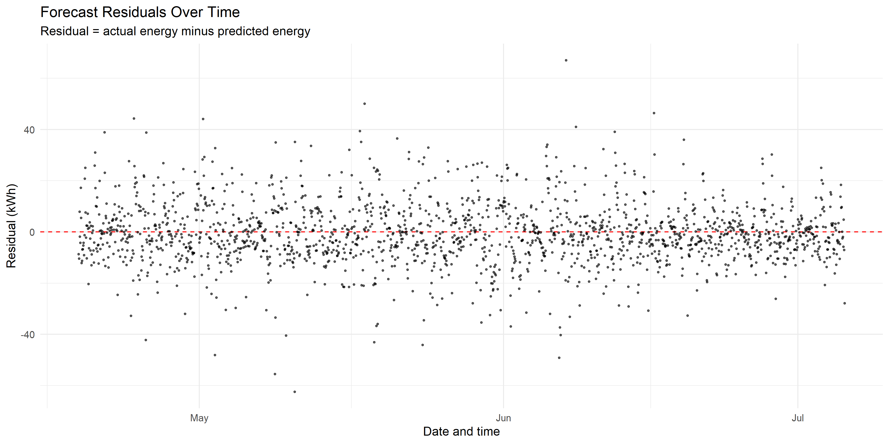
```

### Figure 10. Moving-Block Bootstrap

```{r fig-bootstrap, echo=FALSE, out.width="90%", fig.align="center", fig.cap="Moving-block bootstrap confidence intervals for daily MAE improvement. All tested intervals include zero."}
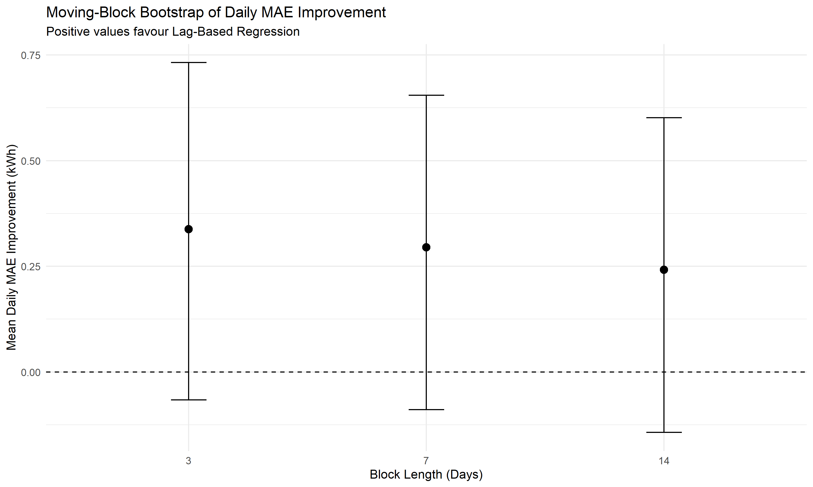
```

------------------------------------------------------------------------

# 15. Energy-Saving Scenario Analysis

The scenario analysis applied hypothetical percentage reductions to the observed total energy of **3,434,469 kWh**.

| Hypothetical reduction | Estimated energy reduction |
|---|---:|
| 5% | 171,723 kWh |
| 10% | 343,447 kWh |
| 15% | 515,170 kWh |
| 20% | 686,894 kWh |

These figures are illustrative scenarios. They are **not measured savings, achieved reductions, or guaranteed outcomes**. Monetary savings were not calculated because a verified applicable electricity tariff was not established.

### Figure 11. Potential Energy Savings

```{r fig-energy-savings, echo=FALSE, out.width="90%", fig.align="center", fig.cap="Hypothetical energy savings under the 5%, 10%, 15% and 20% reduction scenarios."}
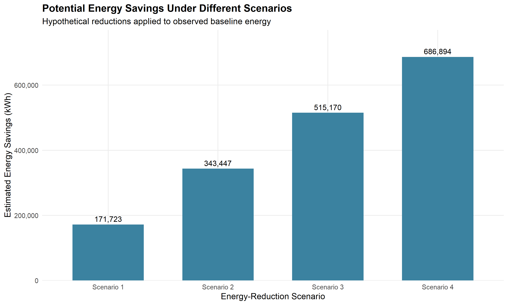
```

------------------------------------------------------------------------

# 16. Business Insights, Recommendations, and Final Visualizations

The business-insight and recommendation stage was completed. The project generated five business insights and six recommendations.

## 16.1 Key Findings

- Overall observation coverage was **87.41%**.
- 2015 had the lowest annual coverage (**72.67%**).
- 2017 had the highest annual coverage (**98.72%**).
- Total observed energy across the analyzed data was **3,434,469 kWh**.
- The lag-based regression had the best MAE among the evaluated forecasting models, with a modest 3.98% improvement over the previous-hour naive baseline.

Annual coverage differs, and 2013 is a partial year. Annual totals should therefore not be interpreted as directly comparable complete-year totals.

## 16.2 Recommendations

| Priority | Recommendation |
|---|---|
| High | Improve hourly meter-data completeness and automate missing-data alerts. |
| High | Investigate missing readings, especially the lower-coverage period in 2015. |
| High | Establish a regular energy-monitoring dashboard with monthly reviews. |
| Medium | Pilot energy-efficiency measures and measure their effects against a baseline. |
| Medium | Use the lag model only as an experimental planning aid and monitor it against the naive baseline. |
| Medium | Investigate high-consumption periods alongside operating schedules. |

These recommendations are general campus energy-management insights derived from a historical case study. They are not direct operational instructions for Heritage Institute of Technology.

### Figure 12. Annual Energy Data Coverage

```{r fig-annual-coverage, echo=FALSE, out.width="90%", fig.align="center", fig.cap="Annual energy data coverage. The dashed 90% line is an illustrative reference, not an official threshold."}
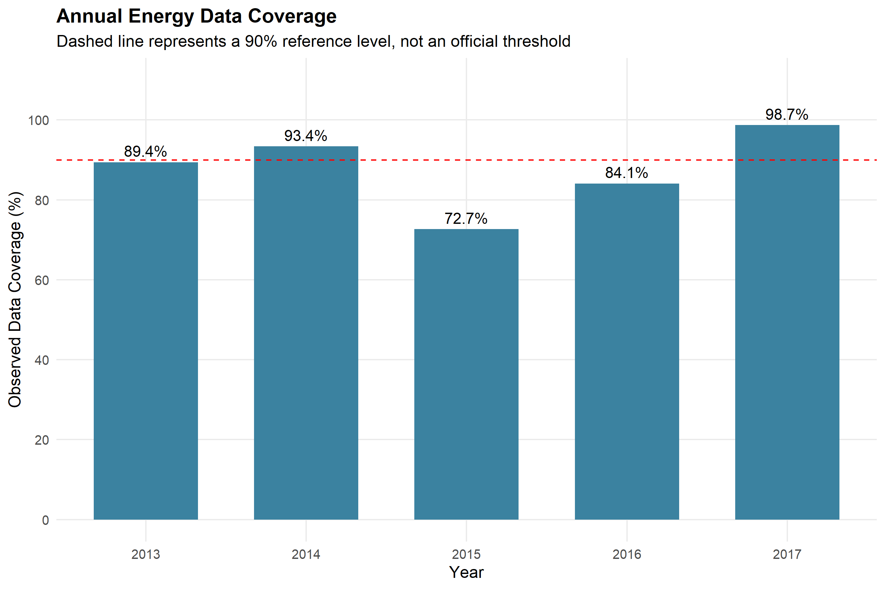
```

### Figure 13. Business Recommendations by Priority

```{r fig-recommendation-priority, echo=FALSE, out.width="80%", fig.align="center", fig.cap="Distribution of the six business recommendations by priority."}
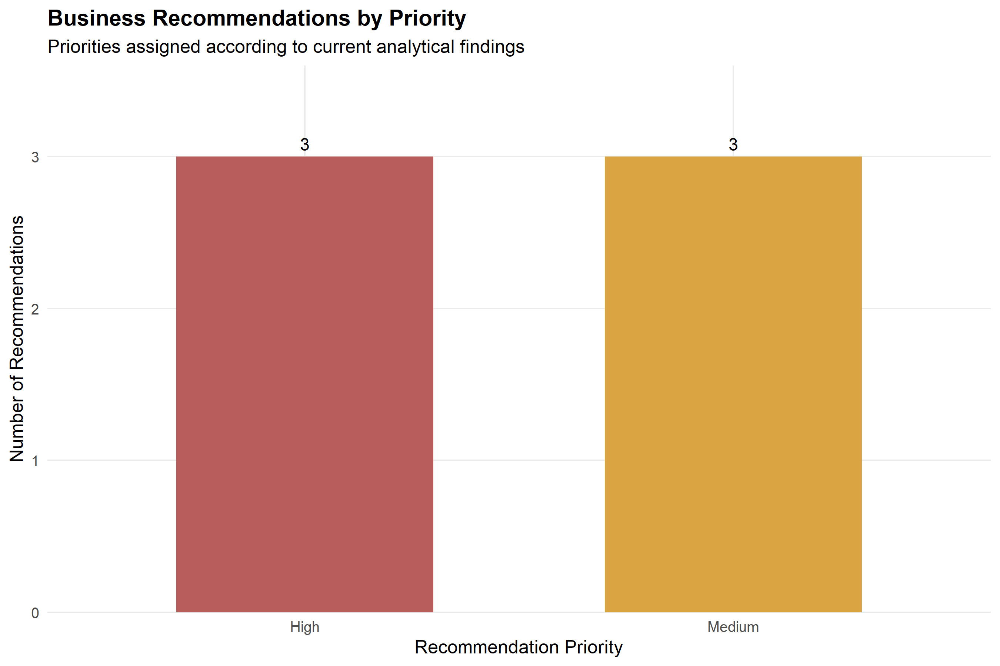
```

## 16.3 Final Outputs

The final analysis produced R scripts, processed datasets, CSV summaries, visualizations, audit outputs, and a final report and presentation. The main deliverable files are linked in the **Final Deliverables** section near the end of this document.

------------------------------------------------------------------------


# 17. Limitations

The following limitations will be considered:

1.  The dataset represents the **IIIT-Delhi campus**, not the user's college.
2.  The main energy dataset is historical and covers a period ending in **2017**.
3.  Supplementary local weather measurements were collected during **2018**.
4.  The dataset should not be interpreted as representing current campus energy consumption in 2025 or 2026.
5.  Several energy streams contain missing observations and irregular time gaps.
6.  Occupancy is estimated using Wi-Fi-based measurements and may not represent an exact physical headcount.
7.  The project-specific campus-level coverage rule is an analytical decision and is not part of the original I-BLEND methodology.
8.  Energy-saving results will be scenario-based estimates rather than guaranteed real-world savings.
9.  Findings from the IIIT-Delhi case study may not directly generalize to every academic campus.

------------------------------------------------------------------------

# 18. Project Progress Log

This section is intentionally kept at the end of the document so that new progress can be added without changing the earlier sections.

## Completed Work

### Dataset and Project Setup

- Selected I-BLEND as the case-study dataset.
- Downloaded the dataset and retained the original documentation.
- Organized the project directory.
- Separated energy, occupancy, calendar, and weather data.
- Removed unnecessary system-generated files.

### Data Preparation

- Created the data inventory.
- Inspected the datasets.
- Validated timestamps, duplicates, time intervals, missing values, and data completeness.
- Identified irregular time gaps.
- Cleaned and standardized the energy data.
- Created missing-data summaries.

### Energy Processing

- Converted minute-level energy data to hourly data.
- Calculated hourly coverage.
- Created building-level hourly energy measures.
- Created the analytical campus-level energy measure using the 5-of-7 building availability rule.

### Occupancy and Calendar Processing

- Processed all seven occupancy datasets.
- Created hourly mean occupancy.
- Created hourly peak occupancy.
- Retained occupancy observation counts.
- Combined institute calendar data.
- Created working-day and activity-level variables.

### Final Dataset

- Merged energy, occupancy, and calendar features.
- Created the final hourly analytical dataset.
- Saved the processed RDS and CSV files.
- Completed the data preparation and feature-integration phase.

------------------------------------------------------------------------

## Progress Updates

New progress updates will be added below this line after each major stage. Previous updates will not be modified.

## Project Progress Update — Exploratory Data Analysis and Energy Analysis

### Step 07: Exploratory Data Analysis (EDA)

Created visualizations to understand the dataset's energy consumption patterns, including:

- Overall campus energy trends.
- Hourly, weekday, working-day and non-working-day consumption patterns.
- Monthly consumption patterns.
- Building-wise energy comparisons.
- Occupancy patterns and occupancy-energy relationships.
- Energy data coverage and availability.

Generated plots were saved in the `plots/` directory, and supporting summary tables were saved in `results/`.

### Step 07B: EDA Validation

Performed additional checks to assess the reliability and comparability of the exploratory findings.

- Examined the number of available building readings for each hour.
- Compared campus energy totals calculated using at least 5, 6 and 7 available buildings.
- Reviewed occupancy data availability and summary statistics.
- Generated a corrected overall energy trend using validated observations.

**Important limitation:** Campus totals based on different combinations of available buildings are not directly comparable. Differences between these totals should not automatically be interpreted as changes in actual energy consumption.

### Step 08: Energy Consumption Analysis

Conducted a more detailed analysis of building-level and campus-level energy consumption.

The analysis covered:

- Average, median and peak energy consumption by building.
- Hourly energy consumption profiles.
- Weekday and monthly energy patterns.
- Daily energy consumption trends.
- High-demand hours and peak-demand observations.
- Building-level comparisons using a minimum hourly meter-coverage threshold of 75%.
- Campus-level analysis requiring at least five qualifying buildings.

The 95th percentile of campus energy demand was used as a threshold for identifying high-demand hours.

### Step 08B: Data Quality Checks

Performed data quality checks without modifying or deleting the original energy observations.

The checks included:

- Missing-value and zero-reading analysis.
- Building-wise data availability summaries.
- Identification of extreme observations using IQR-based thresholds.
- Separate treatment of Lecture building readings when calculating IQR thresholds, because its large number of zero readings would otherwise produce an uninformative threshold.
- Campus total comparability checks based on the number of available buildings.

**Key observations:**

- Lecture energy data contains a substantial number of zero readings. These are flagged for investigation rather than automatically classified as errors.
- Library and Facilities contain observations flagged by the outlier analysis. These require further investigation and are not necessarily incorrect measurements.
- Campus energy totals vary with building availability, so coverage must be considered when interpreting comparisons.

### Outputs Generated

The analysis generated:

- R scripts for EDA, validation, energy analysis and data quality checks.
- PNG visualizations saved in `plots/`.
- CSV summary tables and audit outputs saved in `results/`.

Raw and processed datasets remain excluded from Git tracking through `.gitignore`.

### Limitations and Interpretation

The analysis uses the historical I-BLEND dataset from IIIT-Delhi. It is a case study and methodology template, not a measurement of current energy consumption at Heritage Institute of Technology.

The dataset contains missing and irregular observations, occupancy values are estimates rather than exact headcounts, and the available weather data is from a different year than the energy data. These limitations must be considered when interpreting results.

------------------------------------------------------------------------

## Project Progress Update — Forecasting (Step 09)

Forecasting and model evaluation were completed using a continuous observed hourly segment.

- Checked missing periods and continuous observed runs before modeling.
- Used a chronological 80/20 train/test split.
- Evaluated previous-hour naive, 24-hour seasonal naive, linear trend, calendar regression, and lag-based regression models.
- Compared MAE, RMSE, bias, residuals, and error patterns.
- Investigated model robustness by hour, weekday, and test week.
- Used moving-block bootstrap intervals to assess uncertainty in the MAE difference.

**Interpretation:** The lag-based regression improved MAE by approximately 3.98% over the previous-hour naive baseline, but the bootstrap confidence intervals included zero. The improvement is modest and not conclusive.

The forecasting report and key findings were saved under `reports/` and `results/`.

### Step 09 forecasting evaluation

| Evaluation item | Result |
|---|---:|
| Continuous hourly observations | 9,370 |
| Training observations | 7,496 |
| Test observations | 1,874 |
| Naive baseline MAE | 9.1878 |
| Lag-based regression MAE | 8.8221 |
| MAE improvement | 3.98% |

------------------------------------------------------------------------

## Project Progress Update — Final Visualization and Reporting (Step 10)

Completed the project-wide audit, consistency checks, final visualization selection, visualization refinement, report enhancement, and energy-saving scenario analysis.

The refined forecasting output was checked to ensure that all **1,874 prediction rows** retained hourly timestamps, spanning 2017-04-18 17:00 to 2017-07-05 18:00. The final forecast CSV contains the hourly predictions, and the daily and monthly summary outputs were generated separately.

The reporting workflow generated:

- `reports/09_forecasting_report.md`
- `reports/10f_final_project_report_enhanced.md`
- `reports/10e_final_project_report.md` (if retained from the earlier report-generation step)
- `results/10e_key_findings.csv`
- Refined plots and CSV files in `plots/` and `results/`

The scenario analysis used 3,434,469 kWh as the observed-energy baseline. The 5%, 10%, 15%, and 20% scenarios are hypothetical reductions, not verified savings.

------------------------------------------------------------------------

## Project Progress Update — Business Insights and Recommendations (Step 11)

Step 11 was completed successfully.

- Overall observation coverage: **87.41%**.
- Lowest-coverage year: **2015 (72.67%)**.
- Highest-coverage year: **2017 (98.72%)**.
- Total observed energy: **3,434,469 kWh**.
- Five business insights generated.
- Six recommendations generated: three High priority and three Medium priority.

Generated outputs include:

- `results/11_business_insights.csv`
- `results/11_business_recommendations.csv`
- `results/11_forecasting_business_metrics.csv`
- `plots/11_recommendation_priority.png`
- `plots/11_annual_data_coverage.png`
- `reports/11_business_insights_and_recommendations.md`

------------------------------------------------------------------------

# 19. Final Deliverables

The final report and presentation are provided with this project. If the files are kept in the `deliverables/` folder beside this R Markdown file, the links below will work when the project folder is shared or opened locally.

- [Final project report (PDF)](deliverables/Campus_Energy_Consumption_Analytics_Final_Report.pdf)
- [Final project presentation (PowerPoint)](deliverables/Campus_Energy_Consumption_Analytics_Final_Presentation.pptx)
- [Final project report (Word)](deliverables/Campus_Energy_Consumption_Analytics_Final_Report.docx)

The report is the detailed written record of the project. The PowerPoint is the presentation version of the findings. The Word copy is included for editable review.

## 19.1 Main Project References

1. Rashid, H., Singh, P., & Singh, A. (2019). *I-BLEND, a campus-scale commercial and residential buildings electrical energy dataset*. Scientific Data, 6, Article 190015. https://doi.org/10.1038/sdata.2019.15
2. Rashid, H., Singh, P., & Singh, A. (2017). *I-BLEND dataset collection*. Springer Nature Figshare. https://doi.org/10.6084/m9.figshare.c.3893581

------------------------------------------------------------------------

# 20. Project Completion Status

The planned analysis and reporting workflow for this project has been completed: data inventory and validation, cleaning and hourly aggregation, feature integration, EDA, energy analysis, forecasting, scenario analysis, business insights, recommendations, and final reporting.

This does not mean the analysis is free of limitations. The main limitations remain missing and irregular observations, estimated Wi-Fi occupancy, non-contemporaneous supplementary weather data, and the historical IIIT-Delhi context. The forecasting improvement is modest and statistically inconclusive under the moving-block bootstrap checks.

Optional future extensions could include external validation on another campus dataset, more forecasting approaches with carefully designed time-series validation, and an operational pilot using current meter data from a campus that grants access.